# TraderBot

An asynchronous, multi-bot algorithmic trading framework for **Forex/metals (MetaTrader 5)** and **crypto futures (BitUnix)**.
Each bot watches one or more charts, runs a strategy on every closed candle, opens and manages positions with a stepped take-profit / trailing-stoploss plan, and reports everything to Telegram. Signals, bot configurations and daily PnL reports are recorded in a SQLite database. Strategies can be backtested on CSV kline data with the same code that runs live.

---

## Table of contents

- [Features](#features)
- [Requirements](#requirements)
- [Installation](#installation)
- [Configuration](#configuration)
- [Running](#running)
- [Project structure](#project-structure)
- [Architecture](#architecture)
- [Strategies](#strategies)
- [Indicators](#indicators)
- [Position management](#position-management)
- [Exchange agents](#exchange-agents)
- [Reporting and logging](#reporting-and-logging)
- [Database](#database)
- [Backtesting](#backtesting)
- [Statistics](#statistics)
- [Adding a new bot](#adding-a-new-bot)
- [Adding a new strategy](#adding-a-new-strategy)
- [Adding a new exchange](#adding-a-new-exchange)

---

## Features

- **Many bots in one process** – `BotsManager` runs every bot as its own `asyncio` task, plus a shared position-management loop, an hourly heartbeat and a daily report.
- **Composite multi-timeframe strategies** – e.g. an RSI divergence on the 15m/1h chart that must be confirmed by a CHoCH on the 1m/5m chart.
- **Price-action toolkit** – CHoCH / BOS market structure, swing pivots, static support/resistance zones, auto trendlines with multi-trendline-break (MTR) events, divergences, EMA touches.
- **Stepped positions** – stoploss and several take-profit steps defined by risk:reward ratio and/or fixed pips/percent, with stop trailing after each step.
- **Trading constraints** – limit same-side positions or stop after N losses in a row.
- **Command/Event pipeline** – every trade, report and DB write is a queued `Command`, executed asynchronously and tracked by status.
- **Telegram reporting** – entry charts rendered as images, position updates threaded as replies, daily PnL reports, log files and a DB snapshot uploaded every day.
- **Persistence** – bots are identified by a hash of their full configuration, so signals and PnL reports always map to the exact settings that produced them.
- **Backtesting** – a `BacktestAgent` replays CSV klines and a frozen clock (`TimeHandler`) drives the bot through history.
- **Statistics** – performance, PnL breakdowns, hourly/weekday/session buckets, MFE and stoploss-overshoot analyses with plots.

## Requirements

- **Python 3.13+** (uses `copy.replace`, `asyncio.TaskGroup` and `typing.Self`)
- **Windows** with a MetaTrader 5 terminal installed and logged in, for the MT5 agent (the `MetaTrader5` package is Windows-only)
- A BitUnix API key/secret, for crypto bots
- A Telegram bot token and the channels it may post to

Main libraries: `MetaTrader5`, `pandas`, `numpy`, `sqlmodel`/`SQLAlchemy`, `pydantic-settings`, `python-telegram-bot`, `httpx`, `finplot`/`pyqtgraph`/`PyQt6` (charts), `matplotlib` (statistics plots), `colorlog`.

## Installation

```bash
git clone <repo-url> TraderBot
cd TraderBot
python -m venv .venv
.venv\Scripts\activate          # Windows
pip install -r requirements.txt
```

Create the folders the project writes to, if they do not exist yet:

```bash
mkdir Records Logs Images
```

## Configuration

All secrets and environment-specific values are loaded by [Settings/config.py](Settings/config.py) from a `.env` file in the project root (it is git-ignored). Every field is required:

```dotenv
# Telegram
TELEGRAM_BOT_TOKEN=123456:ABC...           # main reporter bot
TELEGRAM_CHANNEL_ID=@my_signals_channel    # default signal channel
TELEGRAM_REPORT_CHANNEL=-1001234567890     # manager reports / error logs (int)
TELEGRAM_BACKTEST_REPORT_CHANNEL=@my_backtest_channel
TELEGRAM_CRYPTO_CHANNEL_ID=@my_crypto_channel
TELEGRAM_TEST_BOT=123456:DEF...            # bot used by backtest/test logging
TELEGRAM_TEST_CHANNEL=@my_test_channel

# BitUnix
BITUNIX_API_KEY=...
BITUNIX_API_SECRET_KEY=...

# MetaTrader 5
METATRADER_TERMINAL_PATH=C:\Program Files\MetaTrader 5\terminal64.exe
SECOND_METATRADER_TERMINAL_PATH=C:\Program Files\MetaTrader 5 B\terminal64.exe
BROKER_UTC_SHIFT=3                         # broker server time offset from UTC, in hours

# Databases (SQLAlchemy URLs)
LIVE_DB_NAME=sqlite:///Records/LiveBots.db
BACKTEST_DB_NAME=sqlite:///Records/BacktestBots.db
```

Bot parameters (symbols, timeframes, strategy settings, risk) are plain Python in the `configured_bots` modules – see [Adding a new bot](#adding-a-new-bot).

## Running

### Live bot groups

Each top-level script builds a `BotsManager` for one group of bots and runs it until stopped:

| Script | Bots |
| --- | --- |
| [diver_choch.py](diver_choch.py) | RSI divergence + CHoCH and RSI double-divergence + CHoCH on Forex/XAU (MT5) and crypto (BitUnix) |
| [sr_choch.py](sr_choch.py) | Support/resistance touch + CHoCH on Forex/XAU (MT5) and crypto (BitUnix) |

```bash
python diver_choch.py
python sr_choch.py
```

On start the manager sends a start message, prepares every chart on its exchange, stores each bot's configuration in the live DB and starts trading. Stop it with `Ctrl+C`.

> Bots with `consider_position=True` place **real orders**. Use `consider_position=False` for signal-only mode, which reports and records signals without trading.

### Backtest

[backtest.py](backtest.py) picks a configured bot, swaps its chart(s) for `CsvChart`s and replays them:

```bash
python backtest.py
```

### Scratch / manual tests

[test.py](test.py) holds helpers for manual checks, such as creating both databases (`initialize_DBs()`) or opening a single test position on an exchange and watching the manager handle it (`test_positions()`). Read it before running – `test_positions()` opens a real position.

## Project structure

```
TraderBot/
├── backtest.py, diver_choch.py, sr_choch.py, test.py   # entry points
├── Settings/            # .env settings, logger builder, TimeHandler (real/frozen clock)
├── ChartModule/         # Chart, ChartData, Candle, Signal, TimeFrame, MarketSide; finplot figures
│   └── Indicators/      # RSI, MAs, ATR, CVD, pivots, swing pivots, S/R zones, auto trendlines, lines
├── Bots/                # strategies and their configured bots
│   ├── ChochStrategy/        # CHoCH / BOS market structure (ChochQueueFilter)
│   ├── DivergenceStrategy/   # price/oscillator divergence and double divergence
│   ├── EmaStrategy/          # EMA touch, EMA + pivot + CHoCH
│   └── CompositeStrategies/  # multi-timeframe bots: Diver+CHoCH, S/R+CHoCH, MTR
│       └── configured_bots/  # the live bot definitions
├── TraderBot/           # framework core
│   ├── trader_bot.py         # TraderBot: fetch data → check signal → open position
│   ├── bots_manager.py       # BotsManager: runs bots, manage loop, heartbeat, daily reports
│   ├── models.py             # Strategy, Position, Trigger, ExchangeAgent, Command, Event, PnLReport, ReporterBot
│   ├── events.py             # NewSignal, NewPosition, StopLossHit, TakeProfitHit
│   ├── Commands/             # trade, report and database commands
│   └── PositionHandlers/     # TradesManager, position generators, constraints, PnL, statistics
├── ExchangeAgents/      # MT5Agent, BitUnixAgent (+ raw BitUnix REST API)
├── TelegramBot/         # TelegramReporter and message formatting
├── Database/            # SQLModel tables, config hashing, store/fetch helpers
├── BackTest/            # CsvChart, BacktestAgent, BacktestReporter, SignalBacktest, CSV helpers
├── Records/             # SQLite databases (git-ignored)
├── Logs/                # rotating log files (git-ignored)
└── Images/              # README images: strategy charts, Telegram screenshots, statistics plots
```

## Architecture

```
                 ┌──────────────────────── BotsManager ────────────────────────┐
                 │                                                             │
  per bot task:  │  TraderBot.task()                                           │
                 │    ExchangeAgent.get_chartdata()                            │
                 │    Strategy.check_signal()  ──► Signal                      │
                 │    TradesManager.generate_position() ──► Position           │
                 │    NewPosition / NewSignal .occur()  ──► Commands queued    │
                 │    sleep until next candle close                            │
                 │                                                             │
  manage loop:   │  TradesManager.manage_positions()   (every 2 s)             │
                 │    ticks / exchange state ──► StopLossHit / TakeProfitHit   │
                 │  Command.execute_pending_commands()                         │
                 │    OpenPosition, TakeProfit, TrailStoploss, StopLoss        │
                 │    ReportNewSignal, ReportNewPosition, …   ──► Telegram     │
                 │    RecordSignal                            ──► SQLite       │
                 │                                                             │
  heartbeat:     │  hourly lifespan + memory message                           │
  daily (20:xx): │  command stats, memory/profiling, per-bot PnL reports,      │
                 │  PnL rows to DB, log files + DB snapshot to Telegram        │
                 └─────────────────────────────────────────────────────────────┘
```

Key ideas:

- **Strategy vs. bot.** A `Strategy` only answers "is there a signal on this `ChartData`?". A `TraderBot` owns the chart, exchange agent, trades manager and timing. Composite bots subclass `TraderBot` to coordinate several charts and strategies.
- **Only closed candles.** `TraderBot.task()` drops the still-forming candle before checking for signals, then sleeps until the next candle should have closed.
- **Events produce Commands.** An `Event` (e.g. `TakeProfitHit`) creates the trade, report and database commands it needs. Commands are queued and executed together by `Command.execute_pending_commands()`, so strategy code never blocks on network I/O. Reports for later events reply to the original position message.
- **One clock.** All code reads time through `Settings.TimeHandler`. Live it returns real time; in backtests it is frozen and advanced by the simulator.
- **Config identity.** `TraderBot.export_config()` serializes the whole bot (chart, strategy, indicators, generator, constraints). Its hash is the bot's ID in the database.

## Strategies

| Strategy / bot | Location | Idea |
| --- | --- | --- |
| `ChochQueueFilter` | [Bots/ChochStrategy/choch.py](Bots/ChochStrategy/choch.py) | Market-structure engine: swing pivots, BOS and CHoCH (two detection modes), optional Fibonacci retracement filter. |
| `Divergence` / `DivergenceBot` | [Bots/DivergenceStrategy/divergence.py](Bots/DivergenceStrategy/divergence.py) | Price divergence between two charts (e.g. a symbol vs. a correlated one). |
| `OscillatorDivergence` / `OscillatorDiverBot` | [Bots/DivergenceStrategy/oscillator_divergence.py](Bots/DivergenceStrategy/oscillator_divergence.py) | Price vs. oscillator (RSI) divergence. |
| `OscillatorDoubleDiverBot` | [Bots/DivergenceStrategy/oscillator_double_divergence.py](Bots/DivergenceStrategy/oscillator_double_divergence.py) | Two consecutive oscillator divergences. |
| `EmaTouchFilter` | [Bots/EmaStrategy/ema_touch.py](Bots/EmaStrategy/ema_touch.py) | Price touching an EMA in trend direction. |
| `EmaPivotChochFilter` | [Bots/EmaStrategy/ema_pivot_choch.py](Bots/EmaStrategy/ema_pivot_choch.py) | EMA touch at a pivot, confirmed by CHoCH. |
| `OscillatorDiverChochBot` | [Bots/CompositeStrategies/oscillator_diver_choch.py](Bots/CompositeStrategies/oscillator_diver_choch.py) | Divergence on the higher-timeframe `oscillator_chart`, then a same-direction CHoCH (never BOS) on the entry `chart` within `n_candle_confirmation` bars. Set `double_diver=True` for double divergence. |
| `SRChochBot` | [Bots/CompositeStrategies/sr_choch_strategy.py](Bots/CompositeStrategies/sr_choch_strategy.py) | Touch of a static S/R zone (`SRZones`) or dynamic trendline (`AutoTrendlines`) on `sr_chart`, then a same-direction CHoCH on `chart`. |
| `MTRFilter` | [Bots/CompositeStrategies/mtr_bot.py](Bots/CompositeStrategies/mtr_bot.py) | Fires on multi-trendline-break events; runs on a plain `TraderBot`. |

Composite bots report the setup signal (divergence or S/R touch) as soon as it appears, then thread the entry report as a reply to it.

Signal charts as the bots render them for their reports:

<table>
  <tr>
    <td width="50%" valign="top">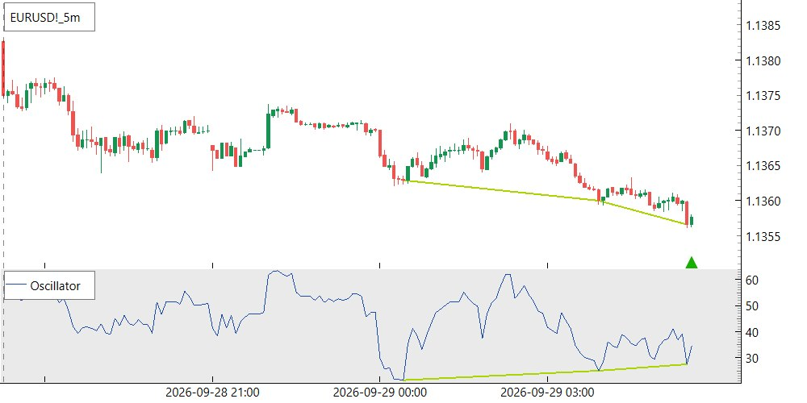<br>Bullish RSI divergence, <code>OscillatorDivergence</code> (EURUSD 5m)</td>
    <td width="50%" valign="top">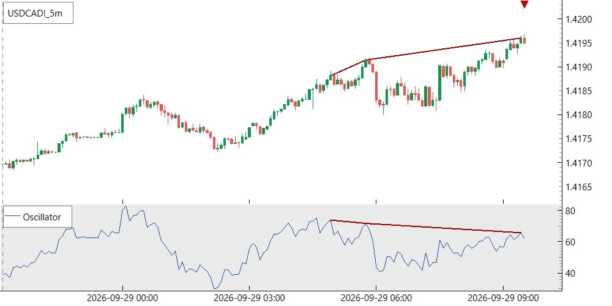<br>Bearish RSI divergence, <code>OscillatorDivergence</code> (USDCAD 5m)</td>
  </tr>
  <tr>
    <td valign="top">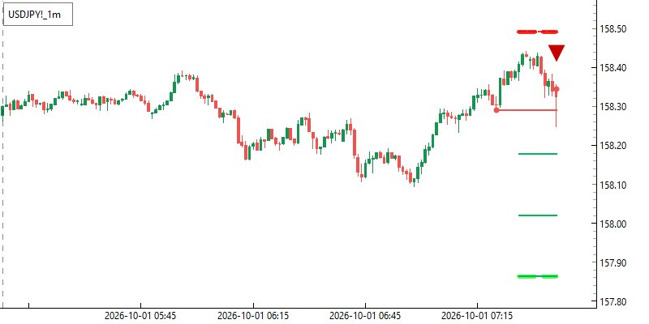<br>Bearish CHoCH entry, <code>ChochQueueFilter</code>, with its stoploss and three take-profit steps (USDJPY 1m)</td>
    <td valign="top">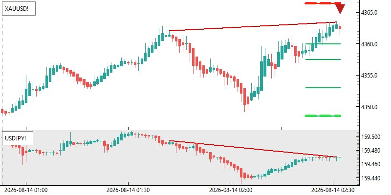<br>Divergence between XAUUSD and USDJPY on Heikin-Ashi candles, <code>Divergence</code>, with the position's steps</td>
  </tr>
  <tr>
    <td valign="top">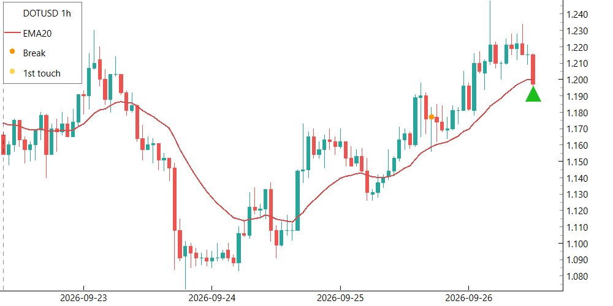<br>EMA touch after a break, <code>EmaTouchFilter</code> (DOTUSD 1h)</td>
    <td valign="top">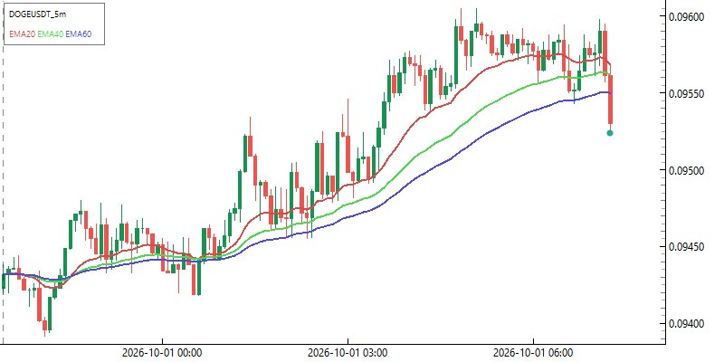<br>EMA 20/40/60 setup, <code>EmaPivotChochFilter</code> (DOGEUSDT 5m)</td>
  </tr>
</table>

## Indicators

All in [ChartModule/Indicators/](ChartModule/Indicators/). Each indicator implements `set(chartdata)`, `forecast()`, `export_configs()` and has a plotter.

- `RSI` (with `RsiBoundryRule`), `SMA`, `EMA`, `WMA`, `HMA` (with `PriceCrossRule`, `SlopeRule`), `ATR`, `CVD`
- `Pivot`, `SwingPivots` – pivot highs/lows with backstep alternation
- `SRZones` – ATR-sized support/resistance zones with merging, touch/break counting and pruning
- `AutoTrendlines` – automatic trendlines, touches, breaks and MTR events
- `LineFinder` / `Line` – generic line detection
- `SupportCandlesPattern` – candle pattern flags used as long/short support conditions

<table>
  <tr>
    <td width="50%" valign="top">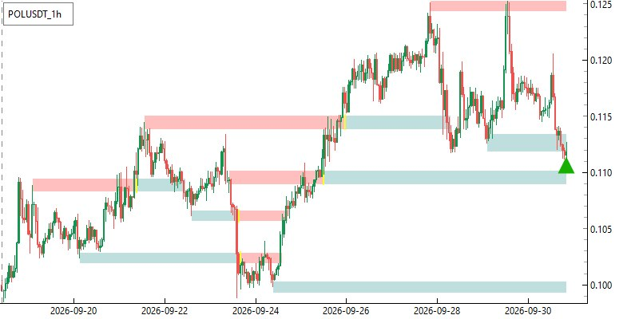<br>Support (teal) and resistance (red) zones, <code>SRZones</code> (POLUSDT 1h)</td>
    <td width="50%" valign="top">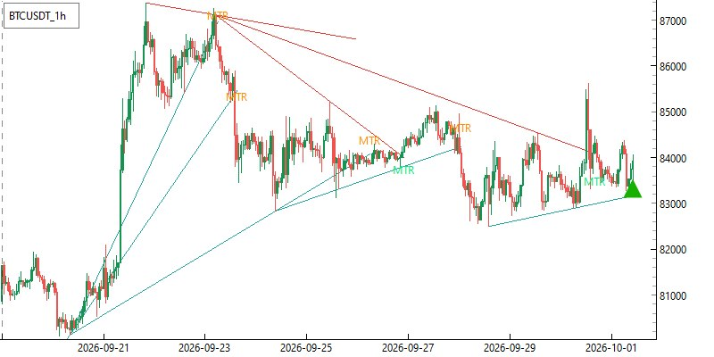<br>Auto trendlines and multi-trendline-break events, <code>AutoTrendlines</code> (BTCUSDT 1h)</td>
  </tr>
</table>

`ChartData` also supports Heikin-Ashi generation, cross-pair series (`generate_crosspair`) and cheap slicing (`subdata`).

## Position management

**`TradesManager`** ([TraderBot/PositionHandlers/manager.py](TraderBot/PositionHandlers/manager.py)) turns signals into positions and manages them:

- respects `long_trade` / `short_trade` switches and every `TradingConstraint`
- takes the entry price from the agent's current tick
- `agent_check=True`: asks the exchange whether steps or the stoploss were hit (live trading)
- `agent_check=False`: checks triggers against recent 1m OHLC prices (signal-only / simulated)
- keeps `current_positions` and `closed_positions`; the daily report flushes the closed ones

**Position generators** ([PositionGenerators/stepping.py](TraderBot/PositionHandlers/PositionGenerators/stepping.py)) build the stoploss and take-profit `Trigger`s:

```python
ForexStepping(
    leverage=1,
    sl_pip=5,                         # stoploss distance in pips
    tp_ratio=[1, 2, 3],               # TPs at 1R, 2R, 3R
    tp_ratio_volumes=[0.01, 0.01, 0.01],  # lots closed at each TP
    tp_pip=[], tp_pip_volumes=[],     # optional fixed-pip TPs
    trail_stop=True,                  # move SL after each TP
)

CryptoStepping(
    leverage=10,
    sl_percent=0.41,                  # stoploss distance in % of entry
    tp_ratio=[1, 2, 3],
    tp_ratio_volumes=[82, 82, 82],    # contract quantity closed at each TP
    tp_percent=[], tp_percent_volumes=[],
    trail_stop=True,
)
```

The position's total volume is the sum of all TP volumes.

**Trading constraints** ([trading_constraints.py](TraderBot/PositionHandlers/trading_constraints.py)):

- `SideConstraint(n_pos_each_side=1, n_bar=30)` – at most N same-side positions within the last `n_bar` candles
- `LoseInRowConstraint(n_long_lose=3, n_short_lose=3, n_bar=30)` – pause a side after N consecutive losses

**PnL** ([trades_pnl.py](TraderBot/PositionHandlers/trades_pnl.py)): `PnLCalculator` gives dollar/percent/pip PnL, and `PnLReportGenerator` builds `PnLReport`s per position, per identifier or overall. `PnLReport`s can be added together.

## Exchange agents

Every agent implements the abstract `ExchangeAgent` in [TraderBot/models.py](TraderBot/models.py): `prepare_chart`, `get_chartdata`, `get_current_tick`, `get_candles_since`, `open_position`, `change_stoploss`, `change_takeprofit`, `partial_close`, `close_position`, `get_open_positions`, `check_position_closed`.

- **`MT5Agent`** ([ExchangeAgents/MT5/agent.py](ExchangeAgents/MT5/agent.py)) – a singleton per terminal path that connects through the `MetaTrader5` package. It fills `precision`, `pip_factor` and `contract_size` on the chart, corrects for broker UTC offset and waits while the market is closed.
- **`BitUnixAgent`** ([ExchangeAgents/BitUnix/agent.py](ExchangeAgents/BitUnix/agent.py)) – USDT-M futures through the signed REST client in [api.py](ExchangeAgents/BitUnix/api.py), with mapped error codes in [error_codes.py](ExchangeAgents/BitUnix/error_codes.py).
- **`BacktestAgent`** ([BackTest/models.py](BackTest/models.py)) – serves CSV data up to `TimeHandler.now()` and simulates fills.

## Reporting and logging

- **`TelegramReporter`** ([TelegramBot/reporter.py](TelegramBot/reporter.py)) sends text, chart images and files. Each configured bot group has its own reporter and channel. `TelegramMsgFormater` formats new signals, new positions, TP hits, SL trails and closes.
- **Charts** are drawn with finplot ([ChartModule/plot.py](ChartModule/plot.py)): `SingleChartFigure`, `DoubleChartFigure`, `ChartWithOscillatorFigure`. Each strategy's plotter draws its indicators and signal, and `PositionPlotter` draws entry, SL and TPs.
- **Logging** is set up with `build_logger(LoggerConfig(...))` ([Settings/custom_logger.py](Settings/custom_logger.py)): colored console output, a rotating file in `Logs/` (1 MB, one backup) and an optional Telegram handler for warnings and errors.
- **`BotsManager`** also sends:
  - an hourly heartbeat with uptime and memory use
  - a daily report at 20:xx UTC with command statistics, memory and profiling reports, per-bot and overall PnL, log files and a consistent SQLite snapshot (files over 45 MB are skipped)
  - an alert after a bot fails 3 times, and a removal notice when it fails more than 6 times

A position in the Telegram channel: the entry report with its chart, then the take-profit hits with their PnL and the trailed stoploss, threaded as replies.

<p>
  
  
</p>

## Database

SQLModel tables in [Database/models.py](Database/models.py):

| Table | Contents |
| --- | --- |
| `Trader_Bots` | identifier, bot type, chart, strategy, `config_hash` (unique), full `config_json` |
| `Signals` | chart, side, source, candle timestamp, linked to its bot |
| `PnL_Reports` | PnL in $ / % / pips, volume, wins/flats/losses, streaks, triggered steps, `overall_report` flag |

- Tables are created automatically by `BotsManager` (live DB), or manually with `Database.create_db(engine)`.
- `Database.methods` provides `store_*` and `fetch_*` helpers for bots, signals and PnL reports.
- Pass `database_name=None` to `BotsManager` to run without recording anything.

## Backtesting

1. Put kline CSVs (columns `open_time, open, high, low, close, volume`, optional `tick_volume`) somewhere on disk. Helpers in [BackTest/methods.py](BackTest/methods.py) can export klines and tick data from MT5 or Binance dumps.
2. Declare them as `CsvChart`s in [BackTest/configured_charts.py](BackTest/configured_charts.py):

   ```python
   BTCUSDT_5m_test = CsvChart(
       "BTCUSDT",
       TimeFrame.five_minutes,
       csv_path=r"D:\TraderBot\BackTest\KlinesCSV\Binance\BTCUSDT-5m-2026-04-05.csv",
       csv_source=KlineSource.BINCANCE,
       ticks_path=None,  # optional tick CSV for excursion analyses
   )
   ```

3. Point a configured bot at them and run `SignalBacktest`:

   ```python
   bot = xau_5m_rsi_choch
   bot.chart = XAUUSD_1m_99000
   bot.oscillator_chart = XAUUSD_5m_50000         # composite bots need every chart replaced
   agent = BacktestAgent(bot.agent, [XAUUSD_1m_99000, XAUUSD_5m_50000])
   asyncio.run(SignalBacktest(bot, agent).run())
   ```

`SignalBacktest` freezes `TimeHandler` at the end of the first `n_candle_check` candles, then calls `bot.task()` repeatedly and advances the clock by the returned delay until the CSV ends. It runs in signal-only mode with a `BacktestReporter` that collects signals, positions and PnL reports in memory instead of sending them. Finally it stores the bot and its signals in the backtest DB and prints a cProfile summary.

`PositionBacktest` runs the same loop but trades. It calls `bot.post_init()` so precision, pip factor and contract size come from the real exchange, fills each position at the open of the running candle (no spread), and manages it on the CSV candles. At the end the closed positions go through a `StatisticsSuite` and its plots are saved to `Images/Statistics/`:

```python
simulator = PositionBacktest(bot, agent, statistics=StatisticsSuite.standard())
asyncio.run(simulator.run())
```

Set `consider_figure = False` on the bot (and on `bot.diver_bot` for divergence composites) to skip rendering a chart for every signal; it makes long backtests much faster.

## Statistics

[TraderBot/PositionHandlers/Statistics/](TraderBot/PositionHandlers/Statistics/) analyses closed positions. `Analyses/` computes results and `Plots/` draws them.

```python
from TraderBot.PositionHandlers.Statistics import (
    StatisticsSuite, MaxFavorableExcursion, StopLossOvershoot, Measure,
)

suite = StatisticsSuite.standard().analyze(bot.trades_manager.closed_positions)
print(suite)                         # performance, breakdown, hourly, weekday, session
suite.plot(label=bot.identifier)     # saves PNGs

mfe = MaxFavorableExcursion(Measure.PIPS, candles_range=30)
mfe.analyze(positions)               # uses CsvChart tick data, or pass tick_source=
mfe.plot(show=True)
```

Available analyses: `PerformanceAnalysis`, `PnLBreakdown`, `HourlyPnL`, `WeekdayPnL`, `SessionPnL` (with `FOREX_SESSIONS`), `MaxFavorableExcursion` and `StopLossOvershoot`.

Plots of a `PositionBacktest` of `xau_5m_rsi_choch` (XAUUSD 1m entries on 5m RSI divergence, January 27 to May 8, 2026, with tick data for the excursions):

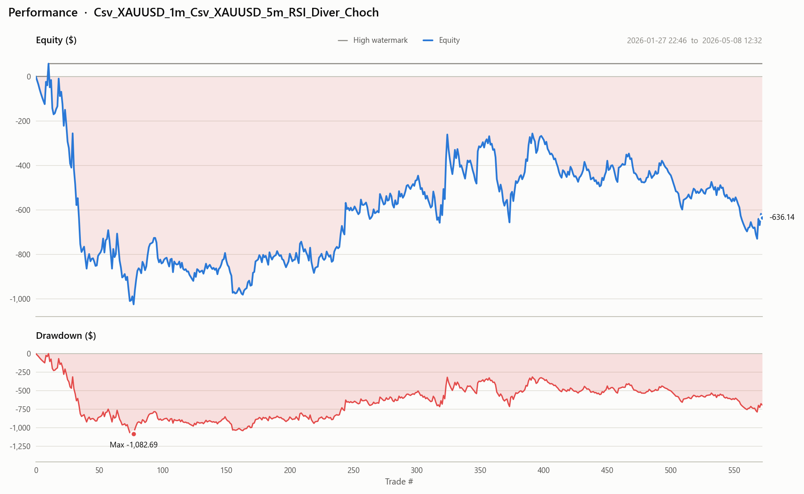

<table>
  <tr>
    <td width="50%" valign="top">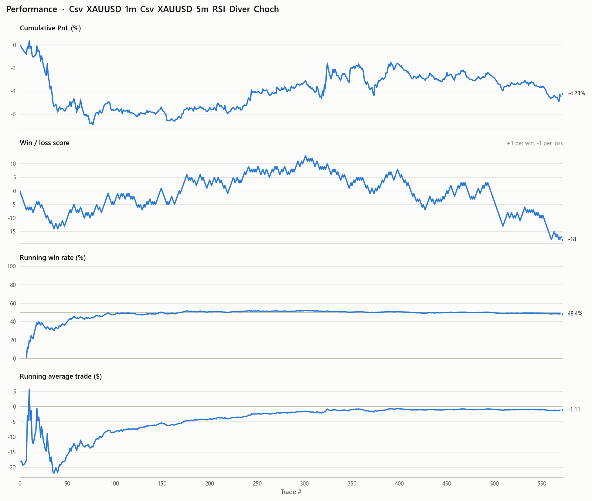<br><code>PerformanceAnalysis</code>: cumulative PnL (%), win/loss score, running win rate and average trade</td>
    <td width="50%" valign="top">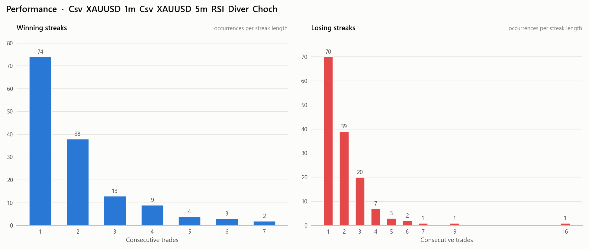<br><code>PerformanceAnalysis</code>: win and loss streak lengths</td>
  </tr>
  <tr>
    <td valign="top">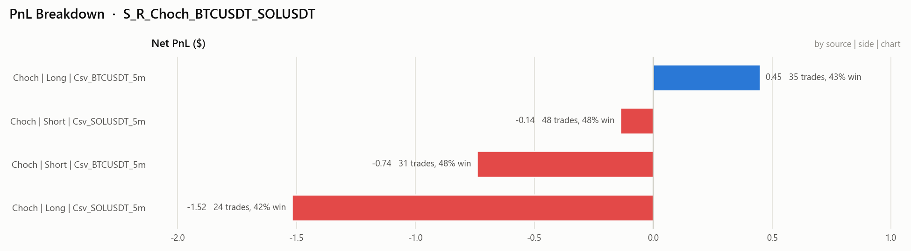<br><code>PnLBreakdown</code>: PnL per source, side and chart, here over the BTCUSDT and SOLUSDT S/R + CHoCH bots (April 14 to May 31, 2026)</td>
    <td valign="top">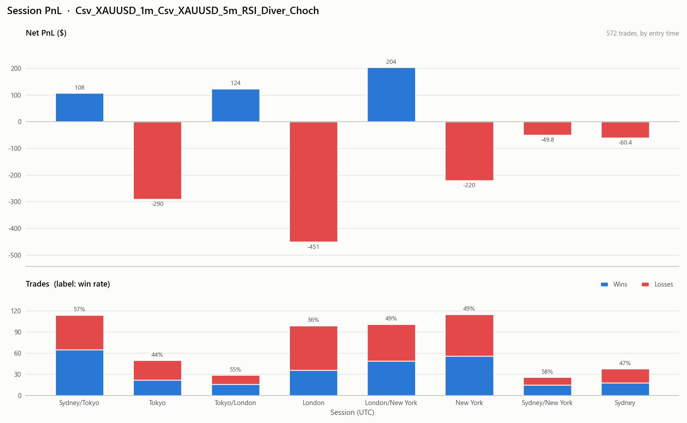<br><code>SessionPnL</code>: PnL by Forex session of entry</td>
  </tr>
  <tr>
    <td valign="top">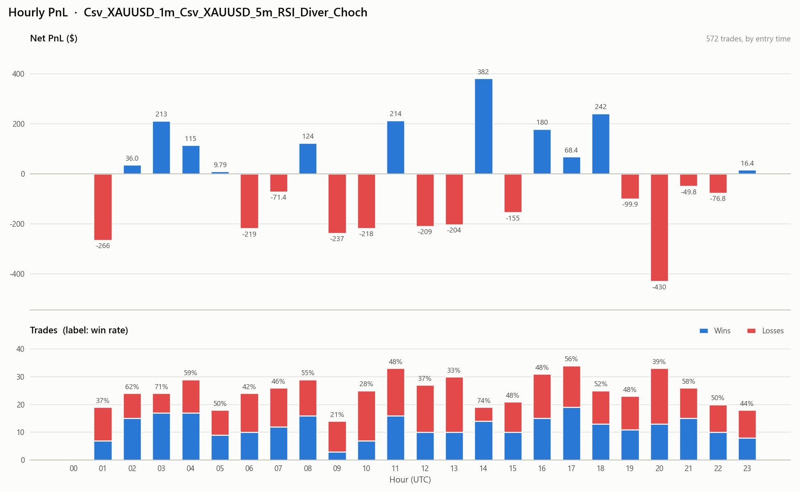<br><code>HourlyPnL</code>: PnL by entry hour (UTC)</td>
    <td valign="top">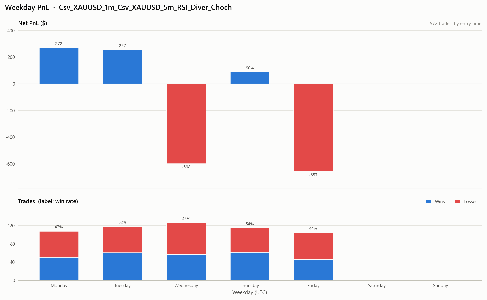<br><code>WeekdayPnL</code>: PnL by entry weekday</td>
  </tr>
  <tr>
    <td valign="top">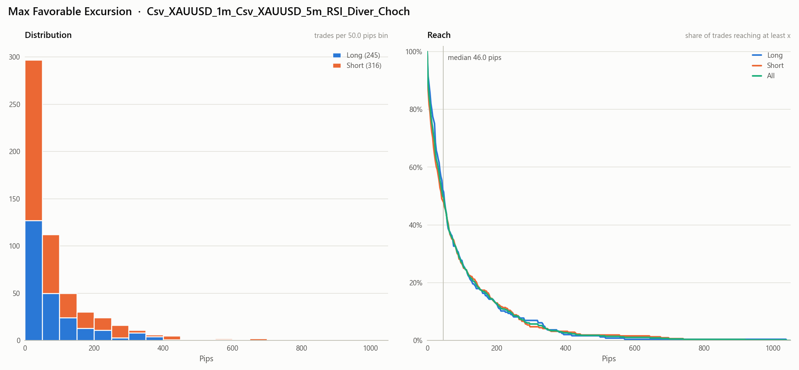<br><code>MaxFavorableExcursion</code>: best move in the position's favour within 30 candles, before the stop</td>
    <td valign="top">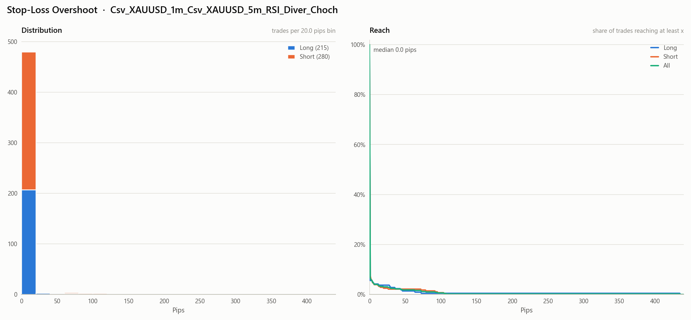<br><code>StopLossOvershoot</code>: how far price ran past the stop before trading back through it</td>
  </tr>
</table>

## Adding a new bot

Bots are declared in the `configured_bots` modules, each as a **complete, explicit block**. Copy an existing block and edit it; there are no factory helpers. Example from [diver_choch_bots.py](Bots/CompositeStrategies/configured_bots/diver_choch_bots.py):

```python
eurusd_5m_rsi_choch = OscillatorDiverChochBot(
    chart=Chart("EURUSD", TimeFrame.one_minute),              # entry chart
    oscillator_chart=Chart("EURUSD", TimeFrame.five_minutes), # divergence chart
    agent=mt5_agent,
    strategy=OscillatorDivergence(
        RSI(), 3, 100, [], name="RSI_Diver", body_candle=True,
    ),
    choch_strategy=ChochQueueFilter(
        pivot_length=2, backstep=2, choch_mode=1, use_bos=False,
        retrace_fib=0.5, use_fibo_filter=True, name="Choch",
    ),
    trades_manager=TradesManager(
        mt5_agent,
        ForexStepping(),
        long_trade=True,
        short_trade=True,
        trading_constraints=[],
        reporter=rsi_choch_reporter,
        agent_check=True,
    ),
    n_candle_check=150,
    consider_position=True,
)
```

Then add the bot to the list passed to `BotsManager` in the matching entry script (`diver_choch.py`, `sr_choch.py`, or a new one).

## Adding a new strategy

1. Subclass `Strategy` ([TraderBot/models.py](TraderBot/models.py)) and implement `check_signal(chartdata, check_long, check_short) -> Signal | None`. Return a `Signal` (or a subclass carrying extra data) for the last closed candle only.
2. Give it a `StrategyPlotter` that draws its objects on a `ChartPane`.
3. Extend `export_config()` with every parameter that affects signals, so the DB hash stays unique.
4. If the strategy needs several charts or multi-step state, subclass `TraderBot` and override `post_init`, `identifier`, `export_config` and `task` (see `SRChochBot` and `OscillatorDiverChochBot`).

## Adding a new exchange

Subclass `ExchangeAgent` and implement its abstract methods. `prepare_chart` must set `chart.precision`, `chart.pip_factor` and `chart.contract_size`. `get_chartdata` must return `ChartData` with timestamps in UTC seconds (`TimeHandler.validate_timestamps` converts ms/µs/ns). `check_position_closed` must set the triggered timestamps of the hit steps and return a `PnLReport` once the position is closed. Then export the agent from [ExchangeAgents/\_\_init\_\_.py](ExchangeAgents/__init__.py).

---

> **Disclaimer:** This software places real orders with real money when `consider_position=True`. Test thoroughly in signal-only mode and on demo accounts first. Trading carries significant risk; use at your own responsibility.
